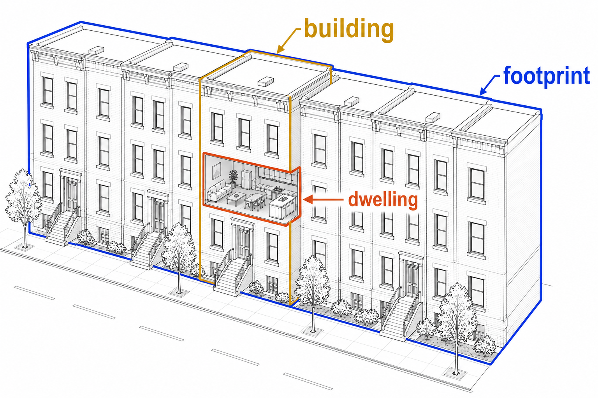

.. openplaces

.. _cheer_footprints:

U.S. building inventory (CHEER)
===============================

The recipe
:gh-file:`US_footprint-cheer-2026 <src/openplaces/recipes/US/_all/footprint/cheer/2026/US_footprint-cheer-2026.yaml>`
creates a footprint-level building inventory for hurricane damage and
exposure modeling in the U.S. It is delivered for 44 counties of
eastern North Carolina and 42 counties of coastal Texas, and is being
tested in Central Florida.

It harmonizes building footprints from multiple polygon sources
(OpenBuildingMap, Microsoft and, in North Carolina, the state's own
footprints), then enriches each footprint with data from linked parcels
and tax rolls, the National Structure Inventory (NSI), Overture
dwelling addresses, FEMA's USA Structures and an earlier CHEER
inventory. The result describes each footprint's occupancy, year
built, stories, dwellings, construction, foundation, roof, garage and
value, and names the source of each value. Where no source has a
value, a model trained on the recorded values fills it
(:doc:`US_footprint-cheer-2026/imputation`).

The pipeline can also use deep-learning-based recognition of building
features (roof shapes, story counts) from Google Satellite and Street
View imagery (similar to
:ref:`BRAILS++ <Cetiner et al. 2025>`). By default, these steps are
turned off to avoid costly downloads and GPU use.

This work is supported by NSF's Coastal Hazards, Economic Prosperity &
Resilience hub (`CHEER <https://www.drc.udel.edu/cheer/>`_).

.. toctree::
   :maxdepth: 1

   US_footprint-cheer-2026/quick-start
   US_footprint-cheer-2026/columns
   US_footprint-cheer-2026/pipeline
   US_footprint-cheer-2026/validation
   US_footprint-cheer-2026/versions
   US_footprint-cheer-2026/research

Imputation version ``building-imputation-v0.8`` (:doc:`US_footprint-cheer-2026/versions`).

.. _cheer_licence:

Licence and attribution
~~~~~~~~~~~~~~~~~~~~~~~

Each bundle carries its terms in ``*_LICENSE.txt``.

- **Share-alike.** Most footprints come from OpenBuildingMap, Microsoft
  and Overture under the Open Database License (ODbL 1.0). Publishing a database derived from these datasets requires releasing it under ODbL 1.0 as well.
- **Attribution.** The sources listed under "Attribution required" in
  the notice (OpenBuildingMap, Microsoft, Overture) must be credited.

**Team bundles stay in the team.** A ``team/`` bundle carries values cleared for the CHEER team only (from sources that prohibit re-publication). Do not share outside the team.

Built on research by
~~~~~~~~~~~~~~~~~~~~

What each work contributed, with full references, is on
:doc:`US_footprint-cheer-2026/research`.

From the CHEER team:

- :ref:`Askari 2026 <Askari 2026>` (imputation: learner, evaluation,
  validity repairs, gap-trained boosting)
- :ref:`Tackie-Otoo et al. 2026 <Tackie-Otoo et al. 2026>` (attributes
  a wind-loss model takes)
- :ref:`CHEER Inventory v0 <CHEER Inventory v0>` (roof, foundation,
  construction, garage, stories)
- :ref:`CHEER Summer Scholars survey <CHEER Summer Scholars survey>`
  (occupancy validation)

From outside CHEER:

- :ref:`Lochhead et al. 2026 <Lochhead et al. 2026>` (matching points
  to footprints, main buildings and outbuildings, splitting a parcel's
  value, dwellings per occupancy class)
- :ref:`Cetiner et al. 2025 <Cetiner et al. 2025>` (BRAILS++: imagery
  scrapers, story counts, roof shapes)
- :ref:`Khanal et al. 2025 <Khanal et al. 2025>` (manufactured-home
  shapes, supporting evidence)
- :ref:`Oostwegel et al. 2025 <Oostwegel et al. 2025>`
  (OpenBuildingMap footprints)
